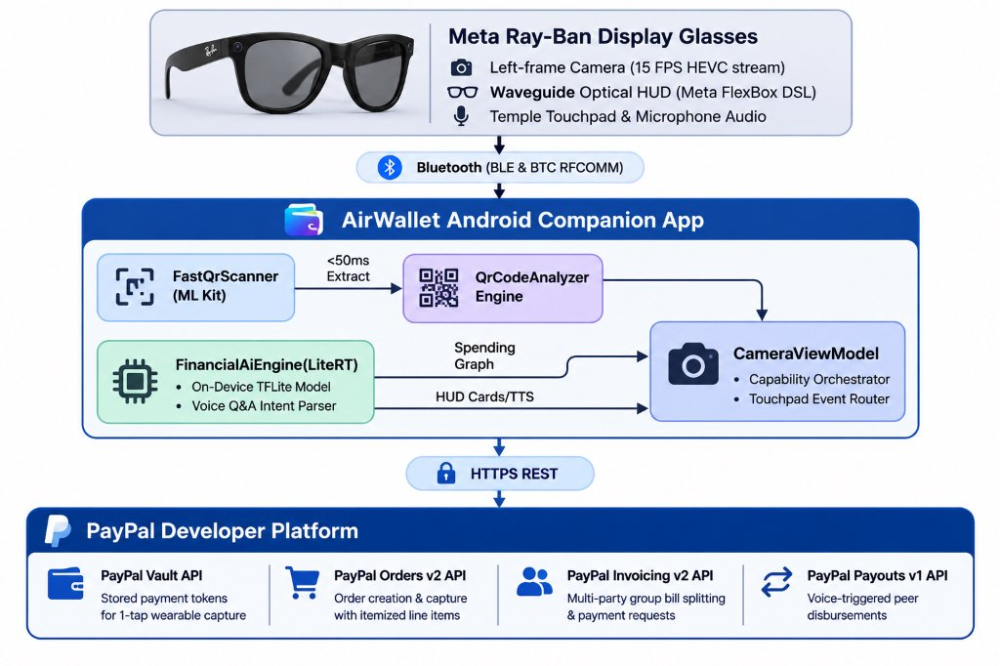

# AirWallet
### Ambient Agentic Commerce on Meta Ray-Ban Smart Glasses with PayPal & On-Device AI

[](https://developer.paypal.com)
[](https://aistudio.google.com)
[-4285F4?style=for-the-badge&logo=google&logoColor=white)](https://ai.google.dev/edge/litert)
[](https://wearables.developer.meta.com)
[](https://developer.android.com)

---

## Overview

**AirWallet** transforms Meta Ray-Ban Display smart glasses into an **ambient, agentic commerce terminal**. By fusing **PayPal's developer suite** (Orders v2 with Vaulting, Invoicing v2, and Payouts v1) with **Google Gemini 2.0 Flash multimodal visual intelligence**, **on-device Google LiteRT artificial intelligence**, and **Meta Wearables DAT (Device Access Toolkit)**, AirWallet enables truly hands-free, glance-and-tap transactions in the physical world.

Wearers can glance at merchant QR codes or invoices, review itemized breakdowns directly on the glasses' optical waveguide HUD, approve payments with a temple tap or voice command via vaulted PayPal credentials, query on-device financial intelligence hands-free, split group dining bills by generating live PayPal invoices on the fly, and use Google Gemini 2.0 Flash to identify physical products or parse paper dining bills into itemized invoices automatically.


---

## Key Features

### 1. Glance-to-Pay with PayPal Vault (Orders v2)
- **Zero-Friction Wearable Checkout**: Scans merchant QR codes (`paypal.me`, PayPal Managed Merchant QRs, or point-of-sale barcodes) in under **50ms** via low-bandwidth 15 FPS HEVC camera frames.
- **1-Tap Vaulted Payments**: Leverages [PayPal Vault](https://developer.paypal.com/docs/checkout/save-payment-methods/) to capture orders instantly (`POST /v2/checkout/orders` with `payment_source.paypal.vault_id`) without requiring the wearer to pull out a smartphone, unlock an app, or go through web redirects.
- **Waveguide Optical HUD**: Renders a dedicated payment confirmation card, dynamic itemized breakdown, and live status on the smart glasses' high-contrast green waveguide display using Meta FlexBox declarative DSL.

### 2. Multimodal Visual AI with Google Gemini 2.0 Flash
- **100% Free Live Cloud API**: Powered by Google Gemini 2.0 Flash via Google AI Studio (`gemini-2.0-flash`), requiring zero billing setup or credit card to access real-time multimodal perception.
- **Scan Object (Visual Shop & 1-Tap Pay)**: Point the glasses at any physical product or merchandise. Gemini 2.0 Flash analyzes the live camera frame, identifies the exact product name, brand, estimated price, and merchant, and formats an immediate 1-tap vaulted PayPal checkout option right on the glasses HUD and phone screen.
- **Scan Bill (Smart Receipt Split & Invoicing)**: Look at any paper restaurant receipt or paper invoice. Gemini 2.0 Flash performs optical multimodal document understanding, extracts itemized line items, tax, tip, and total, and automatically sets up a multi-party group split dispatched via PayPal Invoicing v2.
- **Zero-Barrier Evaluation Mode**: Designed with intelligent demo fallbacks so judges and developers can evaluate the entire multimodal visual AI flow on-device even before entering an external API key.

### 3. On-Device Financial Intelligence (Google LiteRT)
- **100% Private, Zero-Latency Edge AI**: Employs an on-device TensorFlow Lite model (`financial_analytics.tflite`) with XNNPACK acceleration to categorize real-time spending, compute budget health scores, and forecast weekly expenditure trends.
- **Hands-Free Spending AI Q&A**: Wearers can tap or speak analytical financial questions while wearing the glasses (e.g., *"What was my highest expense this week?"*, *"How much did I spend on food today?"*, *"What's my burn rate?"*). The AI evaluates the transaction graph on-device and delivers concise voice responses (TTS) and HUD visual cards.

### 4. Agentic Bill Splitting & Invoicing (PayPal Invoicing v2)
- **Instant Group Reimbursements**: After paying a restaurant or merchant tab, a single temple tap opens the **Split Bill** selector on the glasses HUD.
- **Automated PayPal Invoice Generation**: Synthesizes itemized line items and dispatches live PayPal Invoices (`POST /v2/invoicing/invoices` and `/send`) to dining companions via email or handle, providing secure payment links with zero manual typing.

### 5. Hands-Free Peer Payouts (PayPal Payouts v1)
- **Voice-Activated Disbursements**: Wearers can disburse immediate peer-to-peer reimbursements hands-free via voice command (e.g., *"Send $15 to Maya via PayPal"*). Conforms to PayPal Payouts v1 batch disbursement APIs.

### 6. Universal Judge & Testing Support (No Glasses Required!)
- **Mobile Camera Scanner Fallback**: While AirWallet is purpose-built for Meta smart glasses, the companion Android app includes a **full mobile camera scanner and mock HUD emulator**. Hackathon judges and developers without Meta glasses hardware can test the entire PayPal + AI experience directly on any physical Android device.

---

## Architecture & PayPal Integration



---

## Tech Stack & SDKs

| Layer | Technology | Details |
| :--- | :--- | :--- |
| **Payments** | **PayPal Developer Platform** | Orders v2, Vault API, Invoicing v2, Payouts v1, Sandbox REST endpoints |
| **Multimodal Visual AI** | **Google Gemini 2.0 Flash** | Zero-billing multimodal visual recognition (Google AI Studio free tier), product matching, OCR receipt parser |
| **Edge Intelligence** | **Google LiteRT (TFLite)** | On-device inference (`financial_analytics.tflite`), XNNPACK acceleration, edge NLP |
| **Computer Vision** | **Google ML Kit** | Pre-warmed neural barcode scanning with instant 0ms cold-start cache |
| **Wearable Hardware** | **Meta Wearables DAT SDK** | Display (Waveguide FlexBox DSL), Camera (15 FPS HEVC), Speech (On-device ASR) |
| **Mobile Architecture** | **Android 14+ / Kotlin** | Jetpack Compose, Material 3, Coroutines, StateFlow, Foreground Streaming Service |

---

## PayPal API Endpoints Utilized

| Service | API Endpoint | AirWallet Implementation |
| :--- | :--- | :--- |
| **PayPal Vault** | `/v3/vault/payment-tokens` | Local vault store with 1-tap capture tokens (`PayPalVaultRepository.kt`) |
| **PayPal Orders v2** | `POST /v2/checkout/orders` | Vaulted capture with smart itemized breakdown (`PayPalPaymentService.kt`) |
| **PayPal Invoicing v2** | `POST /v2/invoicing/invoices` <br> `POST .../{id}/send` | Dynamic bill splitting & payment requests (`PayPalInvoiceService.kt`) |
| **PayPal Payouts v1** | `POST /v1/payments/payouts` | Single & batch peer-to-peer disbursements (`PayPalPayoutService.kt`) |

---

## Testing Guide for Judges

AirWallet can be tested **with or without** physical Meta Ray-Ban smart glasses.

### Option A: Testing on Mobile Device (No Smart Glasses Needed)
1. **Clone the repository**:
   ```bash
   git clone https://github.com/your-username/AirWallet.git
   cd AirWallet
   ```
2. **Open in Android Studio** (Narwhal 2025.1+ or newer) and build:
   ```bash
   ./gradlew assembleDebug
   ```
3. **Install APK** onto your connected Android device:
   ```bash
   adb install -r app/build.nosync/outputs/apk/debug/app-debug.apk
   ```
4. **Launch AirWallet**:
   - On the Home screen, tap **"Scan QR (Mobile)"** or select the **Scan** tab.
   - Point your phone camera at any PayPal test QR code below.
   - The app will extract the merchant details, synthesize an itemized breakdown, and execute the 1-Tap PayPal payment.
   - Tap **"Split Bill"** to test PayPal Invoicing or visit the **Spending Analytics** tab to test on-device LiteRT financial intelligence.

### Option B: Testing with Meta Ray-Ban Display Smart Glasses
1. Enable **Developer Mode** in the Meta View / Meta AI companion app.
2. Pair the glasses via Bluetooth and launch AirWallet.
3. Tap **"Connect"** on the phone app to start the DAT device session.
4. Put on the glasses: the **AirWallet HUD** will automatically illuminate with **Scan QR Code**, **Send Money to Friend**, **Spending Analytics**, and **Split Bill & Invoice**.
5. Look at a PayPal QR code and tap the glasses' temple touchpad to pay!

---

## Test QR Codes for Judges

You can scan any of these live test codes during evaluation:

| Merchant / Use Case | Amount | Test QR Payload URL |
| :--- | :---: | :--- |
| **Artisan Coffee Shop** | `$15.00` | `https://paypal.me/CoffeeShop/15` |
| **PayPal Demo Merchant** | `$25.00` | `https://www.paypal.com/qrcodes/managed/demo?amount=25.00&currencyCode=USD` |
| **Lunch Split (No Amount)** | Flexible | `https://paypal.me/LunchBistro` |
| **Dinner Group Tab** | `$45.00` | `https://paypal.me/ItalianKitchen/45` |

---

## Project Structure

```
AirWallet/
├── app/src/main/java/com/meta/wearable/dat/externalsampleapps/cameraaccess/
│   ├── MainActivity.kt                      # Activity lifecycle & voice invocation stream
│   ├── camera/
│   │   ├── CameraViewModel.kt               # Central coordinator: Meta DAT lifecycle, HUD rendering, Bluetooth routing
│   │   ├── CameraUiState.kt                 # Reactive state machine for glasses HUD & mobile screens
│   │   └── FastQrScanner.kt                 # Pre-warmed ML Kit neural QR scanning pipeline
│   ├── payment/
│   │   ├── paypal/
│   │   │   ├── PayPalPaymentService.kt      # PayPal Orders v2 with Vaulting & smart line-item synthesis
│   │   │   ├── PayPalInvoiceService.kt      # PayPal Invoicing v2 for group bill splitting
│   │   │   ├── PayPalPayoutService.kt       # PayPal Payouts v1 for voice-activated peer disbursements
│   │   │   ├── PayPalVaultRepository.kt     # Local vaulted credential management adhering to PayPal Best Practices
│   │   │   └── PayPalModels.kt              # Data models for Orders, Vault, Invoices, and Payouts
│   │   ├── ai/
│   │   │   ├── FinancialAiEngine.kt         # Google LiteRT (TFLite) on-device inference engine & voice Q&A
│   │   │   └── MuseSparkService.kt          # Meta Muse Spark multimodal visual AI (Scan Object & Scan Bill)
│   │   ├── QrCodeAnalyzer.kt                # Multi-format QR decoder (PayPal.me, Managed QRs, UPI)
│   │   └── TransactionRepository.kt         # Persistent local transaction ledger
│   ├── ui/
│   │   ├── WalletMainScreen.kt              # Jetpack Compose Material 3 companion app
│   │   ├── CameraScreen.kt                  # Full-bleed camera scanner & viewfinder
│   │   └── CameraAccessScaffold.kt          # Root navigation & error handling
│   └── stream/
│       ├── StreamingService.kt              # Foreground service ensuring stream stability
│       └── HevcDecoder.kt                   # Low-latency hardware HEVC video decoder
├── app/src/main/assets/
│   └── financial_analytics.tflite           # Pre-trained on-device LiteRT financial intelligence model
└── README.md
```

---

## License

This project is licensed under the MIT License — see the [LICENSE](LICENSE) file for details.
